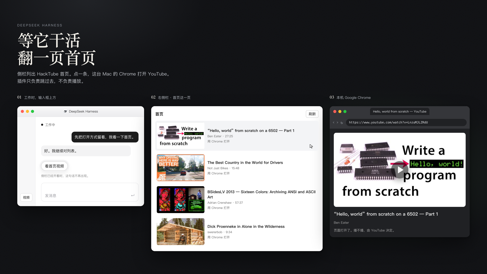

# dsh-hackertube

DeepSeek Harness 插件。Agent 在干活时，侧栏可以翻 [HackTube](https://hackertube.org/) 首页；点一条，用这台 Mac 上的 Chrome 打开对应的 YouTube。插件只负责把片子找出来并跳过去，不负责播放。



效果示意，三步画在同一张图里。片子取自 HackTube 首页的一次真实返回。

## 能做什么

侧栏底部一直有「视频」。Agent 空闲时也能从这里打开列表。

Agent 开始工作、并且侧栏没开着时，输入框上方多出一句「看首页视频」。这句话里没有片单。侧栏已经开着，这句话就不再出现。工作结束，只把这句话藏起来：侧栏不关，Chrome 里的页面也不动。

列表是首页第一页，最多 36 条，顺序跟这次请求一致。点「刷新」再要一次。每条显示标题和封面；首页若带了频道、时长，一并显示。缺的字段留空，不补。

点一条，在 macOS 上执行 `open -a "Google Chrome"`，地址是 `https://www.youtube.com/watch?v=` 加上这条的 id。不改去系统默认浏览器。YouTube 打开之后播不播，由 YouTube 决定。

## 怎么安装

用在桌面版 DeepSeek Harness，配置档是 `desktop`。安装方式在 0.2.2-rc.1 上对过。先完全退出应用，装完再打开。

`dsh` 在应用包里：

```sh
dsh="/Applications/DeepSeek Harness.app/Contents/Resources/runtime/cli/bin/dsh"
```

用本机检出的仓库路径安装。

```sh
"$dsh" plugin --profile desktop add /path/to/deepseek-harness-hackertube
```

命令会把 `dsh-hackertube` 写进 `~/.dsh/profiles/desktop`。然后完全退出并重新打开 DeepSeek Harness。

## 怎么用

1. 点侧栏底部的「视频」，或在 Agent 工作时点「看首页视频」。侧栏打开，并读取首页。
2. 看标题、封面、频道和时长。想换一批，点「刷新」。
3. 点一条。本机 Chrome 打开对应的 YouTube。

刷新失败时，留下上次成功的列表，并写明这次失败了。封面加载失败时，标题还在，封面只剩一块灰底。打不开 Chrome，或这台电脑不是 macOS，侧栏里留下地址，可以复制，不会悄悄换别的浏览器。没有有效 YouTube id 的条目不能点开。

## 它不做什么

不做内嵌播放器，也不控制暂停、倍速或连播。不搜索，不收藏，不记观看历史。不把远程电脑上的点击转到这台 Mac 的浏览器。只取首页第一页，不跟着无限滚动往下要。

## 检查

在仓库根目录：

```sh
node --test
node scripts/verify.mjs
```

`node --test` 不访问网络。`scripts/verify.mjs` 会再请求一次真实首页，并写明本机有没有 `dsh`。Mac 上是否已经装进 DeepSeek Harness，要另外看。
